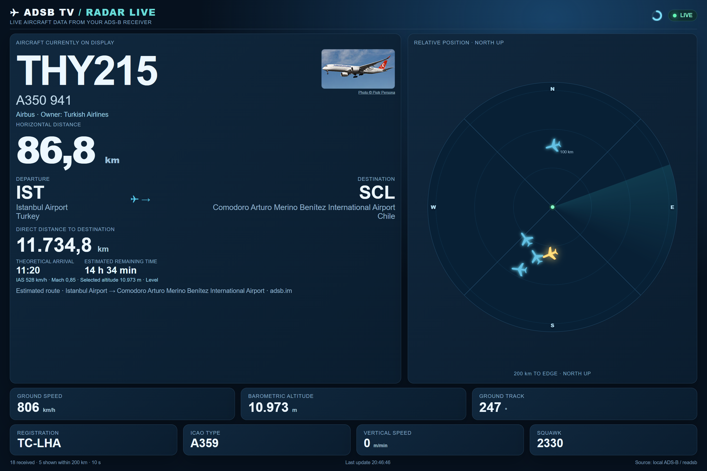
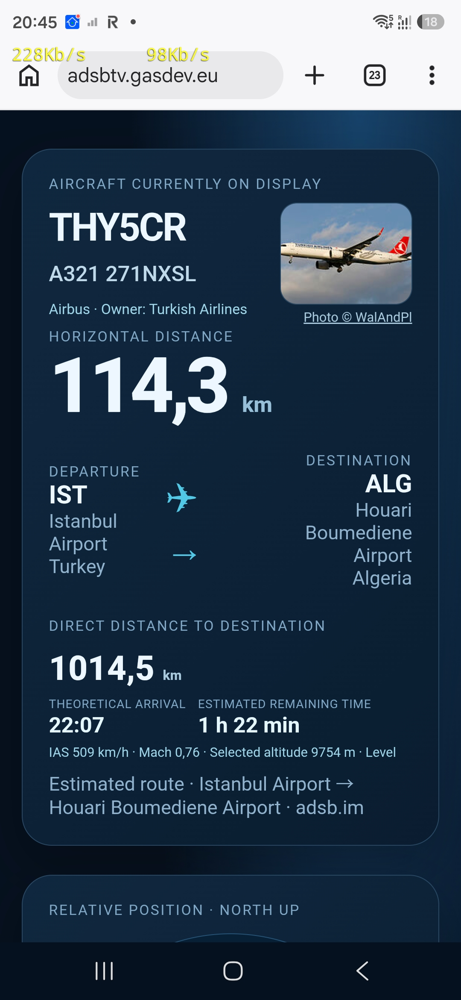
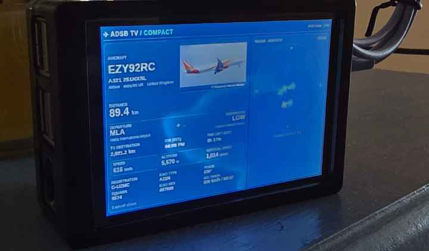

# ADS-B TV Widget

A lightweight, self-hosted ADS-B display widget for PCs, TVs, phones, and embedded devices such as the Raspberry Pi. It turns data from an existing ADS-B receiver into a continuously updating aircraft dashboard in a web browser. The project is a display companion, not a complete ADS-B receiving system.

## Quick setup and configuration

Install the widget on a Linux device with Python 3 and systemd, alongside an existing ADS-B receiver or on another machine that can reach the receiver over HTTP. The widget reads the feeder's `/data/aircraft.json` and `/data/receiver.json`; it does not install or configure the antenna, SDR, or ADS-B decoder.

```bash
git clone https://github.com/gas-dev/ADSB-TV-Widget.git
cd ADSB-TV-Widget
sudo sh install.sh
```

Then open **`http://DEVICE-IP:8090/setup`** on your trusted local network. The setup page exposes the following options, which are saved and retained after restarts:

| Setting | What you can configure | Default |
| --- | --- | --- |
| **Feeder address** | IP address or hostname of an existing ADS-B receiver, local or reachable over the network | `127.0.0.1` |
| **Feeder HTTP port** | Port serving the feeder JSON data, from 1 to 65535 | `8080` |
| **Display language** | English, Italian, Spanish, French, German, or Russian | English |
| **Radar radius** | Show aircraft within **1–500 km** of the receiver | 100 km |
| **Aircraft count** | Track/display the **1–20 nearest** eligible aircraft | 1 |
| **Aircraft rotation** | Switch the highlighted aircraft every **5–60 seconds** | 10 seconds |
| **Distance units** | Kilometres (km), nautical miles (NM), or statute miles (mi) | km |
| **Speed units** | Kilometres/hour (km/h), knots (kt), or miles/hour (mph) | km/h |
| **Altitude units** | Metres (m) or feet (ft) | m |
| **Clock format** | 24-hour or 12-hour (AM/PM) display | 24-hour |

After saving, open **`http://DEVICE-IP:8090/`** for the full dashboard or **`http://DEVICE-IP:8090/compact`** for the smaller-screen layout with aircraft photos, essential flight details and radar. Both views use the same feeder and display settings. Live data is refreshed every second; the configurable rotation interval controls when the highlighted aircraft changes, not the feed polling rate.

**Advanced service options:** `ADSB_TV_PORT` changes the widget's web port (default `8090`), `ADSB_TV_HOST` changes its listening address (default `0.0.0.0`), and `ADSB_TV_READ_ONLY=1` enables public-demo protection, disabling the setup page and settings API. These are service environment variables, **not** controls in the web setup. The installer can also use `ADSB_TV_USER` to select an existing non-root service account. For Internet-facing installations, see [Public demo and security](#public-demo-and-security). Do not expose the normal setup page directly to the Internet.

For hardware requirements, verification commands, updates and troubleshooting, see [Installation](#installation) and the sections below.

## Screenshots

<p align="center">
  <a href="adsbTv_pc.png"></a>
  <a href="adsbtv_mobile.jpg"></a>
</p>

<p align="center"><sub>Desktop / TV dashboard and mobile browser example. Click either image to see it at full resolution.</sub></p>

**Live example:** https://adsbtv.gasdev.eu/  
**Source:** https://github.com/gas-dev/ADSB-TV-Widget

The live demo uses a receiving antenna near Comiso Airport in Sicily, Italy. For geographical reference, the airport's published aerodrome reference point (ARP) is **36°59′45″ N, 14°36′32″ E** (approximately **36.995833° N, 14.608889° E**), **IATA: CIY**. These are **airport coordinates, not the antenna's exact position**.

Aircraft availability depends on the coverage, reception and configuration of the connected feeder.

## Tested ADS-B receiver setup and project scope

This widget has been tested with a **Raspberry Pi connected to an ADS-B receiving antenna**, running the **[adsb-feeder-image project by dirkhh](https://github.com/dirkhh/adsb-feeder-image)**, installed using an image available through **Raspberry Pi Imager**. The feeder image provides the underlying ADS-B reception environment; **ADSB TV Widget** is the separate, lightweight presentation layer that displays aircraft information in a browser.

For installation instructions, supported receiver hardware, ADS-B software, antenna setup, configuration and troubleshooting of the **receiving system**, please consult the original **[dirkhh/adsb-feeder-image documentation](https://github.com/dirkhh/adsb-feeder-image)**. Those components are maintained by their own project and are not bundled with this widget.

ADSB TV Widget is intended to run as a small web-based display on a **desktop or laptop PC, television browser, phone, tablet, or embedded system**. The compact interface has also been tested on a **Raspberry Pi 4 in a case with an integrated SPI touchscreen** (photo and hardware details below). A Raspberry Pi is one tested deployment option, not a requirement: any compatible device with a browser can show the dashboard when it can reach the widget's web service.

## What it does

- Reads live positions from an existing ADS-B / Mode S feeder exposing `/data/aircraft.json` and `/data/receiver.json` (such as compatible readsb/dump1090 installations).
- Shows the nearest aircraft with a valid recent position, on a north-up relative radar.
- Updates telemetry every second and rotates between the nearest selected aircraft at a configurable interval.
- Displays callsign, ICAO address, registration when available, horizontal distance, ground speed, barometric altitude, ground track, vertical rate and transponder squawk.
- Can display aircraft metadata, photographs, airport names/countries, estimated routes and an indicative straight-line arrival calculation when data is available.
- Provides six interface languages: English, Italian, Spanish, French, German and Russian.
- Supports configurable radius (1–500 km), aircraft count (1–20), rotation (5–60 s), km/NM/mi, km/h/knots/mph, metres/feet and 12/24-hour clock.

Missing information is displayed as unavailable rather than being invented.

## Design choices

**Local data first.** Aircraft positions and telemetry come from your configured feeder. Third-party services do not replace local aircraft positions. Distance is computed from the receiver coordinates if the feeder does not provide relative distance.

**Low dependencies.** The application uses the Python 3 standard library and plain HTML/CSS/JavaScript. There is no Python package installation, container, web framework or application database requirement. The ADS-B receiver/decoder itself is a separate prerequisite.

**TV-first layout.** The widescreen landscape dashboard is designed for large, readable information and minimal interaction. A standard browser can display it in full-screen or kiosk mode.

**Optional enrichment.** Aircraft records are requested from HexDB with ADSBdb fallback. Route lookup uses adsb.im with ADSBdb fallback. Airport coordinates and countries are cached from OurAirports data. Aircraft images can come from Planespotters.net or HexDB. External lookups are cached/throttled and may fail without preventing local aircraft tracking. Third-party access is subject to the providers' availability and terms.

**Keep uncertainty explicit.** Origin/destination data may be incomplete or inferred from an external provider. The arrival display uses straight-line distance divided by current ground speed: it is a theoretical indication, not a filed route, operational ETA or navigation instrument. A registered owner is not necessarily the airline operating the flight.

## Requirements

- Linux with Python 3, systemd and an existing non-root local user (tested configuration is Raspberry Pi class hardware; other systemd-based Linux hosts may work).
- An ADS-B feeder reachable by HTTP with `/data/aircraft.json` and `/data/receiver.json`.
- Receiver coordinates in `receiver.json` or distance data in the feed for accurate proximity filtering.
- Network access to the optional enrichment providers if their details are desired.
- A browser on a TV, computer or tablet.

This project is a display companion. It does **not** install an SDR driver, ADS-B decoder, antenna, or feeder.

## Compact display: Raspberry Pi 4 touchscreen installation

The **Compact** dashboard has also been installed on a **Raspberry Pi 4 inside a protective case with an integrated 3.5-inch-class SPI touchscreen**. This is a real, photographed installation, rather than a desktop-only mock-up. The compact layout was developed to make aircraft tracking practical on a small, always-on screen: it places the active flight and its aircraft photograph at the top, keeps flight details legible in a dense information panel, and retains a live north-up radar alongside them. As each aircraft is selected, the photograph, registration, aircraft type, origin/destination and available telemetry follow that aircraft automatically.

<!-- Photograph of the real Raspberry Pi 4 compact installation: add compact_pi4_case.jpg to the repository alongside this README. -->


*Real Raspberry Pi 4 installation showing ADSB TV Compact, a live easyJet aircraft photograph, aircraft data and radar. The photo shows the integrated case and small screen in use.*

### Display and graphics specifications

The following configuration was verified on the pictured Raspberry Pi setup. It describes **this installation**, not mandatory requirements for other Compact users.

| Component | Verified configuration |
| --- | --- |
| Host | Raspberry Pi 4, enclosed in a case with integrated touchscreen |
| Operating system | Debian 13 (Trixie), aarch64, Raspberry Pi kernel 6.18.60+rpt-rpi-v8 |
| LCD controller / kernel module | ILI9486 / `ili9486` DRM framebuffer (`ili9486drmfb`) |
| Touch controller | ADS7846, mapped to `SPI-1` |
| Physical display mode | **480 × 320 pixels**, 30 Hz |
| Reported display size | 73 × 49 mm (DRM output report) |
| Connection | SPI, via `piscreen` overlay |
| Overlay rotation | 0 degrees |
| Tested SPI clock | 16 MHz, 8 MHz and 4 MHz |
| Stable clock reported in this installation | **4 MHz** |
| Window system | Wayland / labwc |
| Remote desktop | WayVNC, port 5900 when enabled |
| Compact webpage | `/compact`, intended for 640 × 480-class landscape layouts |

The physical LCD remains **480 × 320**. A 640 × 480-class workspace on this device is a **logical or scaled desktop**, not an increase in LCD pixel count. A wlroots/labwc output scale can be adjusted for testing, but rendering quality and available logical space depend on the compositor and browser. The 4 MHz SPI setting was reported to remove major corruption during interactive touchscreen use; faster rates produced intermittent horizontal bands in this particular installation. This is a practical observation, not a guarantee that all ILI9486 modules require that clock.

The tested overlay line is:

```ini
dtoverlay=piscreen,drm,rotate=0,speed=4000000
```

### What the Compact view shows

The Compact page at `http://DEVICE-IP:8090/compact` retains the current aircraft's callsign, model, manufacturer and available registration/ownership information, an aircraft **photo with attribution**, distance from the receiver, departure/destination airports, estimated distance to destination, theoretical ETA and remaining time, ground speed, altitude, vertical speed, ICAO aircraft type, registration, heading/track, squawk, ICAO HEX, and available IAS/Mach. The adjacent radar remains north-up and updates from the connected ADS-B receiver.

The photograph uses the same best-effort photo retrieval as the full dashboard, with Planespotters.net and a server-side fallback. If no image is available, a clear placeholder appears instead. Likewise, unavailable flight metadata is shown as unavailable, never fabricated. ETA is a simplified straight-line estimate based on remaining distance and current groundspeed, not an operational ETA.

Compact and full views share the same feeder and language/unit/radar settings. The main dashboard at `/` remains available; Compact has a **Full view** link. You can bookmark `/compact` or launch a kiosk browser directly at that URL. The public read-only demo may also serve `https://adsbtv.gasdev.eu/compact` when that deployment has been updated.

## Installation

On the device that will run the dashboard:

```bash
git clone https://github.com/gas-dev/ADSB-TV-Widget.git
cd ADSB-TV-Widget
sudo sh install.sh
```

The installer copies the application files into `/opt/adsb-tv/`, creates a systemd service named `adsb-tv`, and stores configuration/cache in `/var/cache/adsb-tv/`. It runs under the account invoking `sudo` rather than assuming a username. To select a different existing service user, run `sudo ADSB_TV_USER=youruser sh install.sh`.

Open `http://DEVICE-IP:8090/setup` from a browser on your trusted network. Configure the feeder host and HTTP port. Defaults: feeder `127.0.0.1:8080`, dashboard `8090`, radar `100 km`, one aircraft, rotation `10 seconds`. Then open `http://DEVICE-IP:8090/` on the television. Use the browser's full-screen/kiosk mode if desired.

Example feeder checks, executed on the dashboard host:

```bash
curl -fsS http://127.0.0.1:8080/data/aircraft.json | python3 -m json.tool | head -30
curl -fsS http://127.0.0.1:8080/data/receiver.json | python3 -m json.tool
```

Use the actual feeder address in place of `127.0.0.1` when it runs on another machine.

### Verify the service

```bash
sudo systemctl status adsb-tv --no-pager
journalctl -u adsb-tv -n 60 --no-pager
curl -fsS http://127.0.0.1:8090/api/settings
curl -fsS http://127.0.0.1:8090/api/live | python3 -m json.tool
```

If `/api/live` returns HTTP 503, check the feeder host/port, the HTTP paths and the feeder's receiver metadata. Aircraft are filtered for a recent position and your configured radius, so an empty selection does not necessarily mean the service is broken.

## Updating

**If your local checkout predates the November 2026 initial-publication history reset, follow the [one-time migration instructions](DEMO.md#updating-an-existing-installation) instead of running `git pull --ff-only`.**

```bash
cd ADSB-TV-Widget
git pull --ff-only
sudo sh install.sh
```

Configuration persists outside the Git working tree. Back up `/var/cache/adsb-tv/settings.json` before changing hosts or reinstalling an operating system.

## Public demo and security

For an Internet-facing deployment, follow the complete [public demo deployment and API protection guide](DEMO.md), including expected HTTP status codes, data-minimization checks, reverse-proxy considerations, and updating installations cloned before the repository history reset.

**The default configuration is for a trusted LAN, not direct Internet exposure.** The settings endpoint has no authentication. Do not simply forward TCP port 8090 from your router.

For a public read-only demo, enable `ADSB_TV_READ_ONLY=1`. This disables `/setup`, denies both `GET` and `POST /api/settings` with HTTP 403, and restricts `/api/live` to the display fields required by the TV. The public live response excludes feeder host/port, receiver coordinates, raw feeder records and individual aircraft latitude/longitude. `GET /api/live` and `/api/photo/{icao24}` remain available because the TV needs them. Example systemd override:

```bash
sudo systemctl edit adsb-tv
```

Add:

```ini
[Service]
Environment=ADSB_TV_READ_ONLY=1
```

Then apply:

```bash
sudo systemctl daemon-reload
sudo systemctl restart adsb-tv
```

Publish using HTTPS through a correctly configured reverse proxy or tunnel. Apply appropriate access controls, throttling and network restrictions at the proxy. The read-only option is not a substitute for a security-reviewed Internet deployment. The public API still intentionally discloses aircraft telemetry, relative bearing and distance from the receiver. These observations may allow an observer to **infer an approximate receiver location**, despite the removal of raw coordinates. Do not use the public demo as a guarantee of antenna-location privacy. Browser clients must be able to access `/api/live`; blocking it breaks the TV.

For LAN-only listening, a systemd override can set `Environment=ADSB_TV_HOST=127.0.0.1` when a same-host proxy is used. The default listen address is `0.0.0.0`.

### HTTP endpoints

| Endpoint | Purpose |
| --- | --- |
| `/` | TV dashboard |
| `/setup` | Local setup (disabled in read-only mode) |
| `GET /api/live` | Current display data; reduced fields in read-only mode |
| `GET /api/settings` | Active settings on a trusted LAN; HTTP 403 in read-only mode |
| `POST /api/settings` | Save settings (disabled in read-only mode) |
| `/api/photo/{icao24}` | Optional cached aircraft photo; remains available in read-only mode |

## Data and limitations

The ADS-B data feed may omit aircraft, contain delayed coordinates or have incomplete telemetry. Distances are horizontal great-circle estimates, not three-dimensional slant range. The aircraft selection requires sufficiently recent positions. Route enrichment, aircraft ownership, estimated arrival and photographs are best-effort third-party additions. This is a hobbyist/informational dashboard, not a flight-safety or air-traffic-control system.

Airport data: [OurAirports](https://ourairports.com/data/). Photo and enrichment providers retain their respective rights and terms; photo attribution is displayed when supplied. Review each provider's terms before operating a public or commercial instance.

## License

ADSB TV Widget is **source-available under the [PolyForm Noncommercial License 1.0.0](LICENSE.md)**. Personal hobby use, private noncommercial installations, noncommercial modifications and sharing under the license terms are allowed. This is **not** an OSI-approved open-source license.

**Commercial use requires a separate written license from the copyright holder.** Examples include commercial services, product bundling, paid installations and commercial displays. For commercial licensing, contact **iu0ves@ipaddress.email**. You can also open a [GitHub issue](https://github.com/gas-dev/ADSB-TV-Widget/issues/new) without including private business information.

The standardized license also permits certain noncommercial organizations, as defined in its text. In case of any difference between this summary and the license, the **license text controls**.

Required Notice: Copyright (c) 2026 gas-dev (https://github.com/gas-dev)

This notice applies to the original project code only. Third-party aircraft, airport, route and image data remain subject to their own terms and rights.

## Privacy and contributions

Do not commit local `settings.json`, credentials, access tokens, private addresses, serial numbers, receiver IDs or other installation-specific information. The repository ships generic defaults. If you discover exposed credentials in Git history, revoke them and clean the history separately: deleting a file from the latest branch does not remove historical commits.

Issues and contributions are welcome via [GitHub](https://github.com/gas-dev/ADSB-TV-Widget).
